# NutcesLink

> **CREADO · HRLD CORP CODE** — Harold Charro López · César Espinoza
> **PROPIEDAD INTELECTUAL PRIVADA** · Todos los derechos reservados (ver [`LICENSE`](LICENSE) y [`NOTICE.md`](NOTICE.md))

Sistema multi-tenant para consultorios de **nutrición deportiva**: ficha del paciente, sesiones de **antropometría** con
cálculos verificables (cada resultado muestra su fuente y versión), progreso entre fechas, informe imprimible y **plan
nutricional asistido por IA que el profesional revisa y aprueba** antes de que sea enviable.

**TL;DR (EN):** a multi-tenant sports-nutrition practice system — Postgres Row Level Security isolation, an immutable
anthropometry session model, a deterministic and cited calculation engine, and AI-drafted meal plans that a human must
approve. Portfolio showcase: all data is fictitious. Source is published for reading only (see license).

> ⚠️ **Demo de portafolio.** Todos los pacientes, nombres, medidas y planes de las capturas son **ficticios**. No es un
> dispositivo médico ni sustituye el criterio de un profesional de la salud.

## Capturas

| | |
|---|---|
| 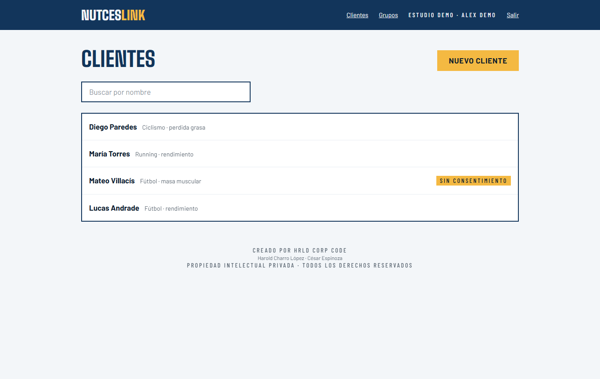 **Clientes** · búsqueda y estado de consentimiento | 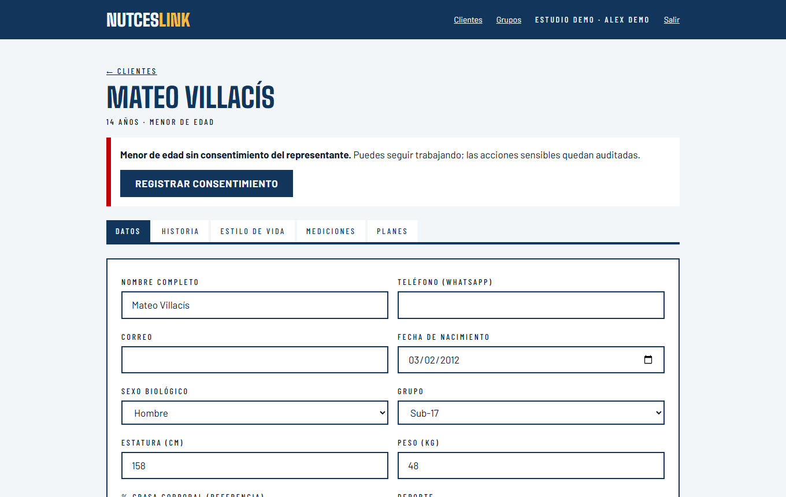 **Aviso de menor sin consentimiento** · no bloquea, queda auditado |
| 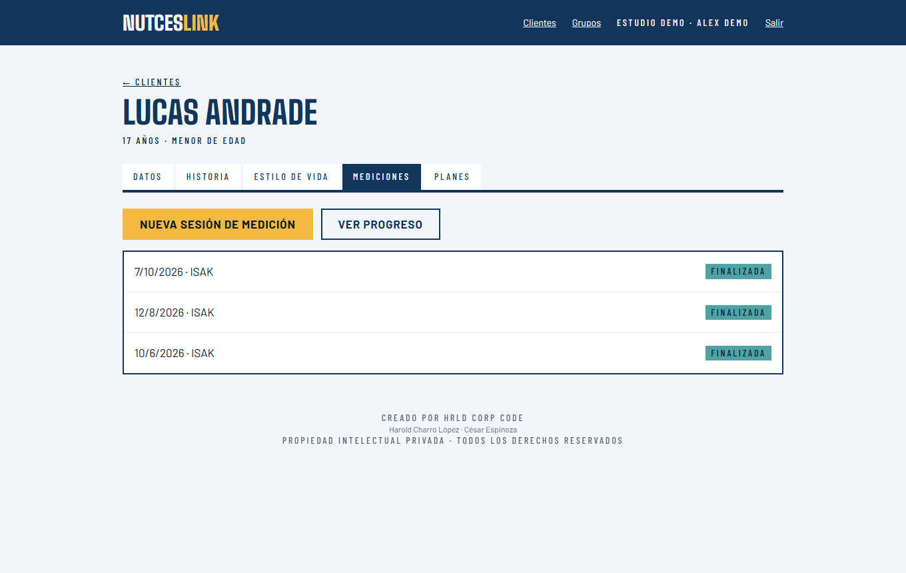 **Sesiones de medición** · borrador / finalizada | 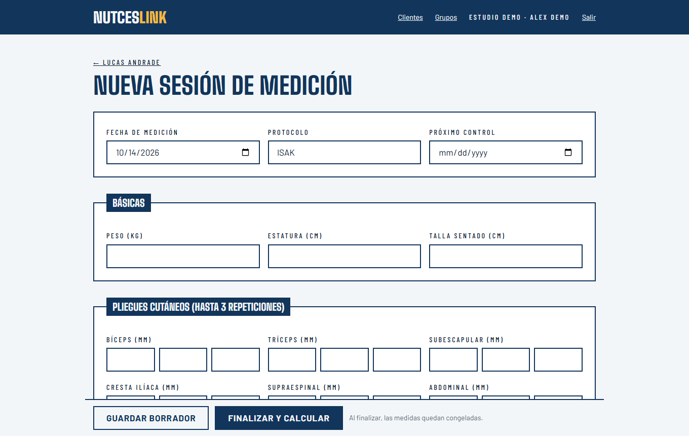 **Formulario de sesión** · hasta 3 repeticiones por pliegue |
| 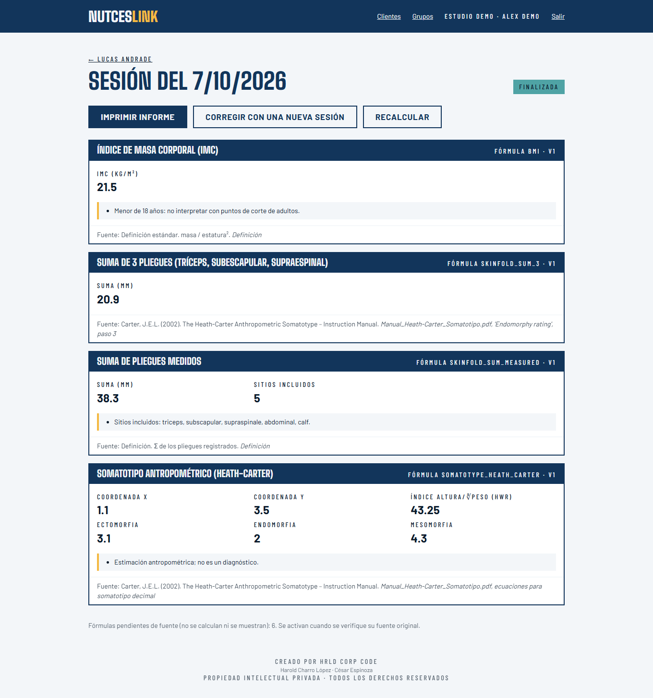 **Resultados con fuente y versión** | 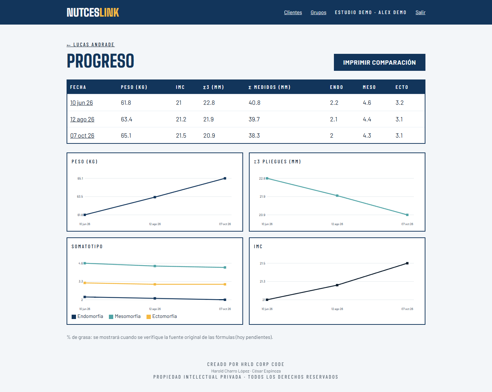 **Progreso entre fechas** |
| 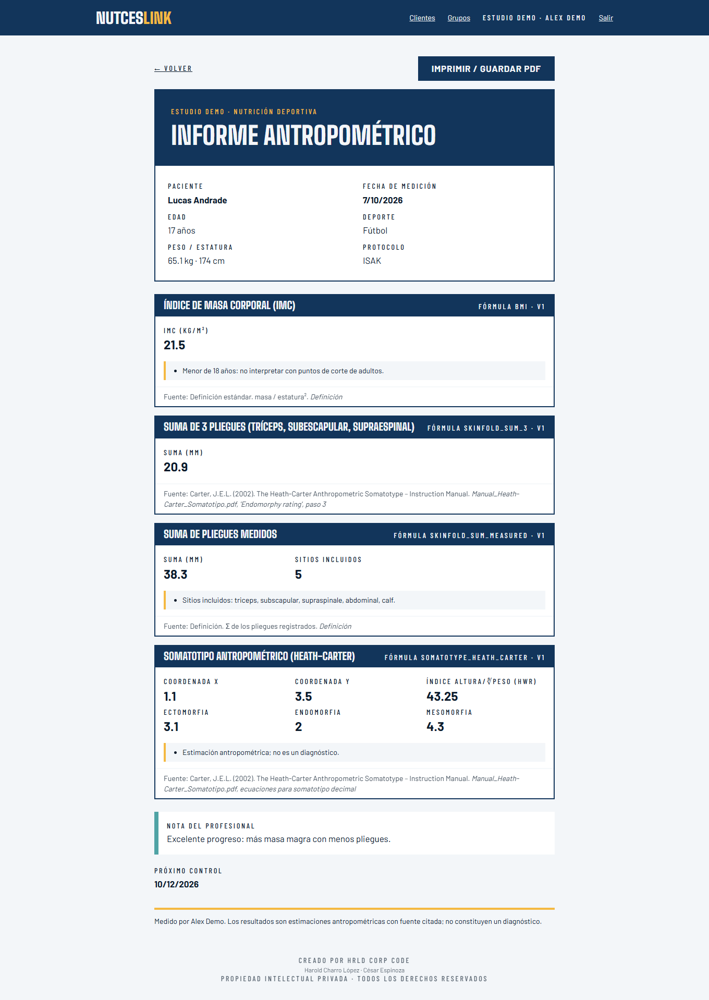 **Informe imprimible** (PDF desde el navegador) | 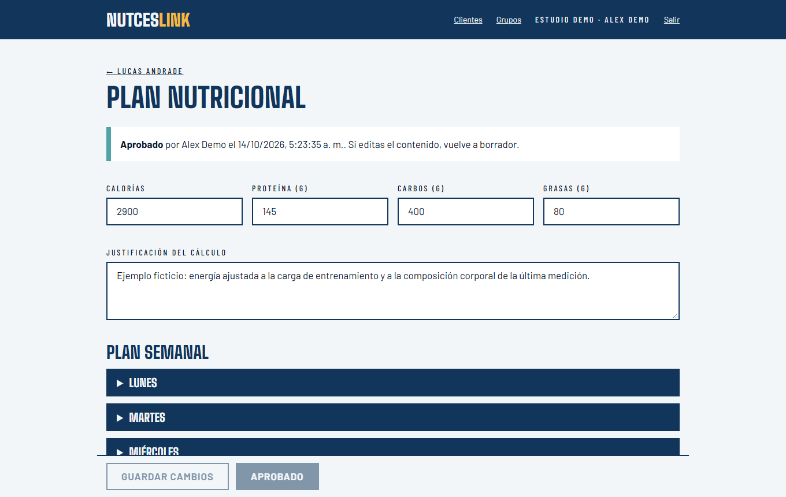 **Plan aprobado** · editar vuelve el plan a borrador |
| 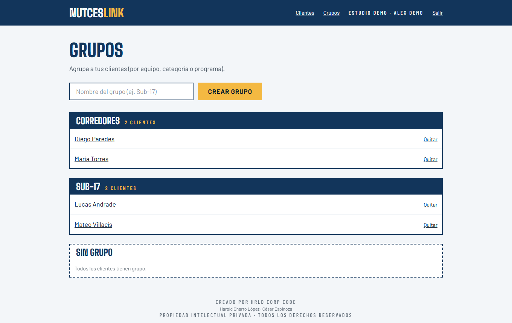 **Grupos** | 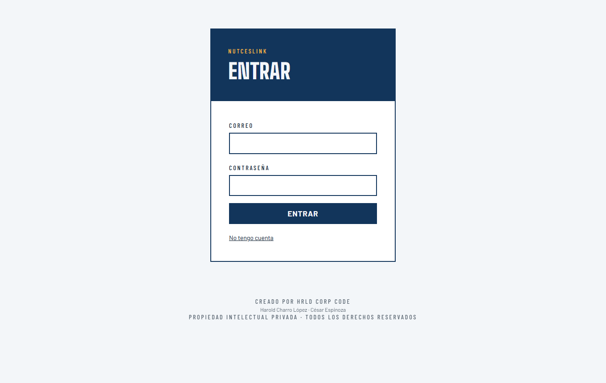 **Acceso** |

## Qué lo hace interesante (técnicamente)

- **Aislamiento real entre consultorios.** Cada fila lleva `studio_id` y la base aplica **RLS**; el frontend no filtra nada.
  Una suite de **59 verificaciones** (dos usuarios en dos studios) prueba que A no puede leer, insertar, actualizar ni
  borrar datos de B, ni mover filas, ni aprobar planes ajenos, ni usar RPCs como usuario anónimo.
- **Datos crudos inmutables, resultados recalculables.** Una sesión finalizada no admite cambios en `raw` (trigger);
  las correcciones son una sesión nueva con `supersedes_id`. Los resultados se guardan por fórmula y versión.
- **Motor de cálculo determinista** (`lib/calc/`): TypeScript puro, sin red ni IA. Cada fórmula declara cita, población y
  `source_status`; **solo las verificadas se calculan y se muestran**. Probado con valores publicados y cálculos
  manuales independientes (17 pruebas).
- **IA con un humano al mando.** La Edge Function genera un borrador validado con **zod** (si el JSON es inválido, no se
  inserta nada); un plan solo es enviable con `coach_approved = true`, que únicamente puede fijar la RPC `approve_plan`.
  Editar un plan aprobado lo devuelve a borrador. Tope diario por consultorio y datos mínimos hacia el modelo
  (sin nombre, teléfono ni correo).
- **Privacidad por diseño.** Auditoría append-only sin contenido médico, consentimiento registrado (menores: aviso
  visible y evento auditado), claves de servicio nunca en el navegador.

## Arquitectura

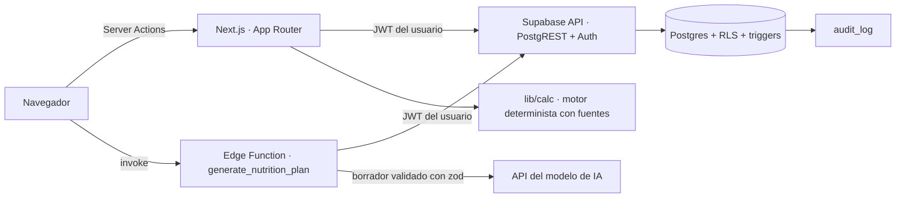

Stack: Next.js (App Router) · TypeScript · Tailwind · Supabase (Postgres, Auth, RLS, Edge Functions) · zod.

## Estructura

```
app/            pantallas (login, onboarding, clientes, sesiones, progreso, informe, planes, grupos)
components/     formularios, resultados con fuente, gráficas SVG, editor de plan
lib/calc/       motor de cálculo + registro de fórmulas (verified | pending_source)
supabase/       migraciones SQL (RLS, triggers, RPCs) y la Edge Function
tests/          aislamiento (v1 + v2), cálculo y función
scripts/        datos de demostración (ficticios) y generador de capturas
```

## Ejecutarlo en local

Requisitos: Node 22+ y Docker.

```bash
npm install
npx supabase start -x imgproxy,vector,logflare     # API :57321 · Studio :57323 · correos :57324
cp .env.example .env.local                          # URL http://127.0.0.1:57321 + publishable key de `supabase start`
export SUPABASE_URL=http://127.0.0.1:57321 SUPABASE_ANON_KEY=<publishable> SUPABASE_SERVICE_KEY=<secret>
node scripts/seed-demo.mjs                          # datos ficticios → demo@nutceslink.local / demo-nutceslink-2026
npm run dev -- -p 3200
```

Pruebas:

```bash
npm run test:calc                  # 17 · motor de cálculo
node tests/isolation.test.mjs      # 25 · aislamiento entre consultorios
node tests/isolation_v2.test.mjs   # 34 · sesiones, inmutabilidad, menores
```

El botón **«Generar plan con IA»** requiere una `ANTHROPIC_API_KEY` propia en `supabase/functions/.env` y
`npx supabase functions serve`; sin ella la función responde con un error claro y no inserta nada.

## Estado y límites (a propósito, sin maquillaje)

- Corre **solo en local**; no hay despliegue público.
- Las fórmulas de **% de grasa** (Slaughter, Durnin & Womersley, Withers/Siri) y las sumas de 4/6/8 pliegues están
  registradas como `pending_source` y **ocultas** hasta verificar su fuente original. Hoy se calculan IMC, suma de pliegues
  y somatotipo Heath-Carter.
- El somatotipo está verificado contra las ecuaciones del manual de Carter (2002); debe validarse con un caso real antes
  de cualquier uso clínico.
- Los rangos de captura son de *plausibilidad* (detectan errores), no normas por edad y sexo.
- Falta una revisión legal de datos de salud de menores (LOPDP / RGPD) antes de operar con personas reales.

## Autoría

Creado por **HRLD CORP CODE** — Harold Charro López · César Espinoza. **Propiedad intelectual privada.**
Código visible solo para lectura y evaluación; cualquier otro uso requiere autorización escrita.
